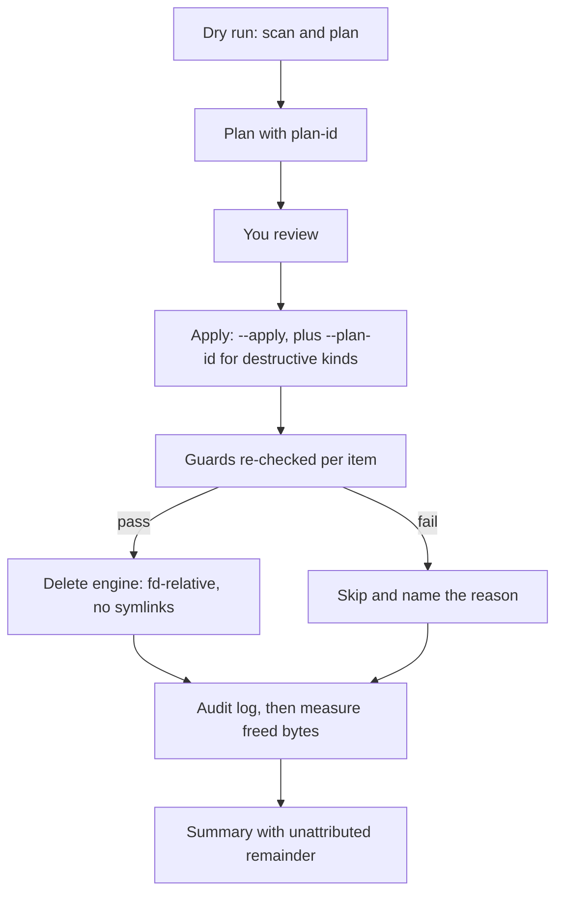

# disk-cleanup

**Reclaim disk space. Review first. Count every byte.**

Caches, stale git worktrees, `node_modules` and `target` trees, Docker and Steam leftovers fill a developer machine without being the work. `disk-cleanup` finds them, shows you a plan, deletes only a plan you applied on purpose, and then reports how much each item actually freed.

> **Status: pre-release, under construction.** Nothing below is published yet: no crate, no Homebrew formula, no release binaries. The command surface in this README is the design in `project_plans/rust-disk-cleaner/design/ux.md`; the one terminal session shown is real output, the rest are marked `TODO-OUTPUT`. Sections that need real output carry `TODO-OUTPUT` markers.

Fast, safe disk-space cleaner for developer machines: dry run by default, bytes freed measured. Linux x86_64 and aarch64 (btrfs-aware) and macOS arm64; the aarch64 and macOS builds are tested on CI runners only (see Platforms). MIT licensed.

## Why

On 2026-11-04 the author's bash cleanup script took a btrfs root from 70 GiB to 312 GiB free. Its output itemised about 11 GiB of the roughly 241 GiB it freed, so there was no way to tell what had been deleted or what had actually freed the space. It also deleted by default, took about two minutes per run, and never looked at the biggest consumers (build directories, unused Docker images and volumes, Steam/Proton leftovers, btrfs unallocated space).

`disk-cleanup` is the replacement, with four rules: it never deletes on a bare run, it never deletes a destructive kind you did not review, it measures freed bytes against the filesystem instead of estimating them, and it prints the part it cannot explain.

<!-- TODO-OUTPUT: add a one-line link to the first real run's numbers (attribution %, run time) once the owner's first three real --apply runs exist. Do not quote the 10x or 95% targets as results. -->

## What it looks like

A bare run is a dry run. This is real output from a build of this repository (`disk-cleanup 0.1.0`, the default features: only the `caches` kind lists), run with `HOME` pointing at a fixture holding a 5 MB fake npm cache and a 3 MB fake Go build cache. The `Filesystem` block describes the machine it ran on, the author's btrfs root. Which kinds can delete is decided per release gate, so `Scanned 0 roots` and the `not available in this build` note are expected here.

```
$ disk-cleanup
DRY RUN - nothing will be deleted.   plan-id 4b7ee9f4
Scanned 0 roots in 0.4s (cache cold, walker backend, 0 dirs, 0 unreadable)

Selected now  (--kinds caches,worktrees)      would free   7.6 MiB   2 items
Estimates are file-size sums; reflinks or snapshots can make the disk free less.

Filesystem ~  (btrfs)
  df             used 1.67 TiB of 1.82 TiB   avail 144.2 GiB
  data           used 1.62 TiB of 1.76 TiB allocated
  metadata       used 26.3 GiB of 29.5 GiB
  unallocated    1.0 MiB                              verdict: CRIT

Next:
  disk-cleanup --apply
      the 2 FREE rows (selected now)

STATUS KIND         SIZE   AGE  ITEM
FREE   caches    4.8 MiB    3d  ~/.npm/_cacache
FREE   caches    2.9 MiB    0s  ~/.cache/go-build

Notes:
  not available in this build: worktrees, build-dirs, docker, docker-images,
    docker-volumes, steam, btrfs, btrfs-trim
DRY RUN - nothing was deleted.
```

<!-- TODO-OUTPUT: an `--apply` transcript with the per-item freed bytes and the Attribution block. `--apply` is not registered in the default build yet (it ships with Gate B), so there is no real output to paste. The layout is in design/ux.md S3. Do not invent one. -->
<!-- TODO-OUTPUT: a dry run that shows the RISK rows, `build-dirs` and `docker`, and the `+ would free` lines: needs a build with gate-c. -->
<!-- TODO-OUTPUT: asciinema cast or GIF of: dry run -> copy a Next: line -> apply -> summary. Embed here. -->

## Features

- **Dry run by default.** A bare `disk-cleanup` deletes nothing. Deleting needs `--apply`. There is no `--force`, no `--yes`, and no interactive "yes to all". `-n` and `--dry-run` are accepted as no-ops, and together with `--apply` they are a usage error (exit 64).
- **Destructive kinds need a reviewed plan.** `build-dirs`, `docker-volumes`, `steam` and `--worktree-ignored discard` additionally require `--plan-id <id>`: the id of a dry run of the same selection, saved in the last 24 hours and equal to the id recomputed at apply time. A new, vanished or newly skipped item changes the id, so an apply can never delete something the dry run did not show. Risky kinds also have to be named in `--kinds`; there is no `all`.
- **Per-item bytes freed, measured.** Each removed item reports the bytes it freed, and the summary compares their sum with the filesystem's own drop (btrfs `data` bytes_used, or `df` on other filesystems). The unattributed remainder is always printed, never hidden; reflinks and snapshots are the usual cause.
- **A delete engine that refuses on doubt.** Deletion is file-descriptor relative and refuses symlinks, other filesystems and anything outside the per-kind allowed roots. Guards run again immediately before each delete, because scan results can be minutes old. A dirty or locked worktree, a running build or a referenced Docker volume is skipped and named, with the next command to run.
- **Checked independently.** The delete engine and its path guards are tested by tests written separately from the code, including adversarial path cases; `disk-cleanup audit verify` re-checks every logged deletion against a separate, reviewed table of allowed roots and exits non-zero if any deletion falls outside it. <!-- TODO: link the adversarial test suite and ci/allowed-roots.txt once they are public. -->
- **btrfs aware.** It reports data, metadata and unallocated space, detects snapshots that may hold space, and can run balance and trim as separate, explicitly named kinds. It does not claim chunks were returned unless a re-read shows it.
- **Built for agents too.** `--json` prints exactly one document with `schema_version: 1`; exit codes distinguish partial failure, fatal errors and btrfs starvation; refusals are data under `--json`.
- **Plain-text output.** ASCII, one record per line, no spinner, no cursor movement, colour only as a redundant tint on words (`FREE`, `REFUSED`, `ERR`).

How an apply flows:



## What it cleans

Tiers decide the gate: **safe** kinds run on `--apply` alone, **guarded** kinds must be named in `--kinds` (the default set also includes `worktrees`), **destructive** kinds must be named and also need a reviewed `--plan-id`. Run `disk-cleanup kinds` for the live list and what is available on your machine.

| Kind | Tier | Platform | What it touches | Notes |
|---|---|---|---|---|
| `caches` | safe | Linux, macOS | npm, Go build, Gradle, pip, cargo registry, Playwright browsers; Homebrew, Xcode, JetBrains on macOS | measured bytes include `go clean -cache` and `pip cache purge` |
| `cache-apt` | safe | Linux | `/var/cache/apt` | needs root |
| `worktrees` | guarded | any | stale agent worktrees (`.claude/worktrees/agent-*`) | removed with `git worktree remove`, never `rm -rf`; clean, unlocked, older than 14 days |
| `build-dirs` | destructive | any | `node_modules` (next to `package.json`), cargo `target` (next to `Cargo.toml`) | keeps the newest duplicates; 60-minute floor; skips running builds |
| `docker` | guarded | any with Docker | dangling images, build cache | skipped if the daemon is down |
| `docker-images` | guarded | any with Docker | unused tagged images pulled from a registry | locally built images are skipped |
| `docker-volumes` | destructive | any with Docker | unreferenced volumes | anonymous and named volumes each need their own opt-in flag; never `docker system prune` |
| `steam` | destructive | Linux | orphaned Proton prefixes, shader caches, uninstalled-game remnants | prefixes holding saves are protected by default |
| `btrfs`, `btrfs-trim` | guarded | Linux, btrfs | balance, fstrim | need root; reported separately from freed bytes |

Not cleaned by design: Maven's local repository, source files, `.git`, lockfiles, anything outside the allowed roots. Not supported: Windows, remote machines, cloud storage. <!-- TODO: confirm this table against `disk-cleanup kinds` output at release; kinds not built yet print "not available in this build". -->

## Install

> **Not published yet.** Every command in this section works only after the first release. Until then, build from source.

```bash
# Homebrew (Linux x86_64 and aarch64 via Linuxbrew, macOS arm64) (after the first release)
brew install tstapler/tap/disk-cleanup

# GitHub release archives and shell installer (after the first release)
# TODO-OUTPUT: paste the installer one-liner that cargo-dist prints in the first release notes.
# Archives: disk-cleanup-x86_64-unknown-linux-gnu, disk-cleanup-aarch64-unknown-linux-gnu, disk-cleanup-aarch64-apple-darwin (.tar.xz)

# cargo (after the first release, and only if crates.io publication happened; see Platforms)
cargo install disk-cleanup

# From source (today)
git clone https://github.com/tstapler/disk-cleanup   # TODO-OUTPUT: the repository is not pushed yet
cd disk-cleanup && cargo install --path crates/cli
```

### Platforms

| Platform | Archive | brew | cargo install | How it is tested |
|---|---|---|---|---|
| Linux x86_64 | yes | yes (Linuxbrew) | yes | the author's machine (btrfs, real hardware) and a CI runner |
| Linux aarch64 | yes | yes (Linuxbrew) | yes | a **CI runner only** (GitHub-hosted `ubuntu-24.04-arm`); never run on the author's own aarch64 hardware |
| macOS arm64 (Apple silicon) | yes | yes | yes | a **CI runner only** (GitHub-hosted `macos-15`); the author has no Mac, so nothing was run on real Mac hardware |

Not built: macOS on Intel, musl (static) Linux, Windows. The minimum glibc version of the Linux archives is stated in the release notes (<!-- TODO-OUTPUT: the floor measured on the first CI-built archive; RELEASE.md "glibc floor" explains why the local figure of 2.39 is not it -->). **What "CI runner only" does not cover**: on aarch64, real-disk timing and page-size differences; on macOS, apfs and Time Machine local snapshots, your real Homebrew and Xcode caches, `lsof` behaviour under load, and Gatekeeper's handling of a downloaded binary. btrfs-specific features (allocation report, shared-extent estimate, balance, trim) are tested on the author's Linux machine; they are not exercised on the CI runners unless that run says so. The 12.7 s speed target is measured only on the author's Linux machine.

## Workspace layout

The repository is one Cargo workspace of five crates, all published to crates.io in dependency order. Only `disk-cleanup` is meant to be installed; the others are internal and carry no stability guarantee.

| Crate | Role |
|---|---|
| `disk-cleanup-scan` | read-only scanner: parallel walker, incremental cache, btrfs reader, build-dir clustering (the former `metascope`, history preserved) |
| `disk-cleanup-core` | domain types, guards, planner, executor; no direct dependency on `rustix` or `libc` |
| `disk-cleanup-adapters` | the only crate that unlinks: the fd-relative delete engine, probes, audit log |
| `disk-cleanup-tui` | the storage explorer's terminal UI |
| `disk-cleanup` | the binary: argument parsing, rendering, exit codes |

## Quick start

```bash
disk-cleanup                   # 1. dry run: read the plan, nothing is deleted
disk-cleanup --apply           # 2. delete the safe rows (caches, stale worktrees)
disk-cleanup --kinds build-dirs                          # 3. dry run a destructive kind; copy the Next: line
disk-cleanup --apply --kinds build-dirs --plan-id <id>   # 4. apply exactly what you reviewed
disk-cleanup status            # filesystem usage and verdict (exit 0 ok, 1 warn, 2 crit)
disk-cleanup scan              # read-only per-repo and per-directory inode and metadata report (the former `metascope scan`)
```

<!-- TODO-OUTPUT: run each command above on a real machine and paste the real ids and output. -->

Every `Next:` line in a plan report is a complete, paste-ready command that reproduces the plan you reviewed. Commands that need root print the absolute path of the binary after `sudo`; `disk-cleanup` never calls `sudo` itself.

Exit codes: `0` ok, `1` partial failure, `2` fatal or unsafe, `3` btrfs starved (refused before any delete), `64` usage error, `74` state unreadable, `130`/`143` interrupted.

## Storage explorer (planned)

An interactive, read-only, ncdu-style view of where your space went is in scope but **not built yet**. The working design: a size-sorted directory tree with drill-down that updates while the scan runs, btrfs-aware columns (metadata cost, shared-extent estimate) that ncdu cannot show, any deletion going through the same plan-and-apply engine and guards (never a separate delete path), and a fall back to the linear text output when stdout is not a TTY. Design is in progress under `project_plans/rust-disk-cleaner/tui/`; names and flags are not final.

## How it compares

Different tools answer different questions. `disk-cleanup` is a cleaner for developer machines with a plan-first workflow; it is not a general disk-usage browser. Claims below come from each project's own README or docs (checked 2026-11-08).

| Tool | What it is | Overlap with disk-cleanup | Where it differs |
|---|---|---|---|
| [BleachBit](https://github.com/bleachbit/bleachbit) | System cleaner for Windows and Linux that frees disk space and maintains privacy; GUI and CLI; GPL-3.0 | Free space on Linux; offers a Preview before Delete | Targets system and application cleaners and privacy; Windows support; GUI. disk-cleanup targets developer artefacts, has no GUI, and ties destructive applies to a plan id |
| [ncdu](https://dev.yorhel.nl/ncdu), [gdu](https://github.com/dundee/gdu), [dua](https://github.com/Byron/dua-cli) | Disk-usage analysers with an interactive terminal UI; gdu and dua can delete from the UI, ncdu has a `--enable-delete` option | Finding what uses space; gdu has `--exclusive-size` for reflinks on btrfs/XFS | Analysers first; disk-cleanup knows what is a cache, worktree or build dir. The disk-cleanup storage explorer is planned, not built; use these today for browsing |
| [`docker system prune`](https://docs.docker.com/reference/cli/docker/system/prune/) | Removes unused containers, networks, images and build cache, optionally volumes | The Docker part of `docker`, `docker-images`, `docker-volumes` | Docker-only; prompts unless `-f`. disk-cleanup lists before deleting, checks volume references and age, and never calls `docker system prune` |
| [kondo](https://github.com/tbillington/kondo), [npkill](https://github.com/voidcosmos/npkill) | Clean build artefacts from projects (kondo: 20+ project types; npkill: `node_modules`) | `build-dirs` | Per-project tools with their own conventions (npkill has `--dry-run`). disk-cleanup adds the shared plan/apply gate, audit log and measured bytes, and covers more than build dirs |
| [cargo-sweep](https://github.com/holmgr/cargo-sweep) | Cargo subcommand that deletes old or unused build artefacts from `target/` (by age, toolchain or size; has `--dry-run`) | cargo `target` | Finer-grained inside `target/` (disk-cleanup removes the whole directory). Its README currently lists it as unmaintained and points to cargo-clean-all |

If you only need to look at disk usage, ncdu, gdu or dua are the better tool. If you only clean one ecosystem and are happy with it, the per-ecosystem tools are simpler.

## Safety and security

What is guarded, and how it is tested, is listed under Features. Deleting user data is the whole job, so the path guards are the security boundary. In short: nothing outside the per-kind allowed roots, no symlink following, no cross-filesystem deletes, no network access, and every deletion is written to an append-only audit log (`$XDG_STATE_HOME/disk-cleanup/audit.jsonl`) before it happens.

What this does not promise: deleted data cannot be recovered, estimates can overcount under reflinks and snapshots (which is why the remainder is printed), and the tool has not had an external security audit.

**Reporting a vulnerability.** Please do not open a public issue. See [SECURITY.md](SECURITY.md). <!-- TODO (OWNER): fill the reporting address and response time in SECURITY.md and enable private vulnerability reporting in the repository settings. -->

A path-guard bypass, a deletion outside the allowed roots, or an `--apply` that deleted a destructive kind without a matching plan id are treated as security bugs.

## Contributing

Issues and pull requests are welcome. New cleaner kinds are the natural entry point: they sit behind the existing guard traits. Changes to the delete engine need the adversarial tests extended in the same change. Conventional Commits drive the changelog.

```bash
lefthook install        # fmt + clippy pre-commit
cargo test --workspace
```

See [CONTRIBUTING.md](CONTRIBUTING.md) and [RELEASE.md](RELEASE.md).

## Related

`disk-cleanup scan` is the former `metascope scan`, a read-only diagnostic, now part of this repository; the separate `metascope` project is archived and its history lives here under `crates/scan`. The old `metascope status` is `disk-cleanup status`. <!-- TODO: the metascope repo has no GitHub remote today; add the archive link only if it was ever pushed. -->

## License

MIT. See [LICENSE](LICENSE).
